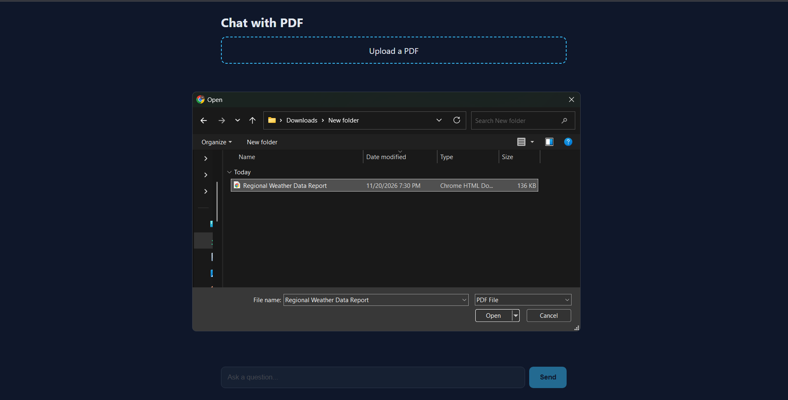
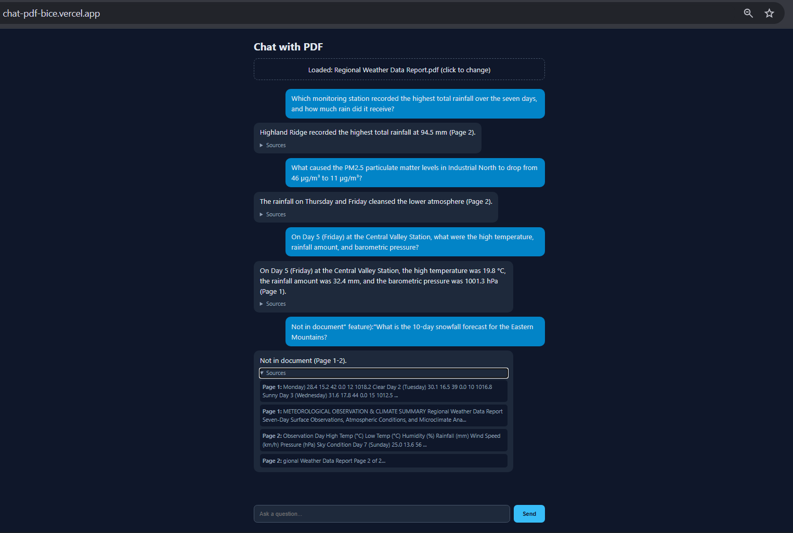

# Chat with PDF (RAG)

Upload a PDF and ask questions about it. Answers are generated only from the document, with source page numbers.

**Live demo:** https://chat-pdf-bice.vercel.app
(Backend runs on a free tier, so the first request may take ~50 seconds to wake up.)




## How it works
1. PDF text is extracted page by page
2. Text is split into overlapping chunks (800 chars, 100 overlap)
3. Each chunk is converted to an embedding (Gemini) and stored in MongoDB
4. The question is embedded and compared with all chunks using cosine similarity
5. The top 4 chunks are sent to Gemini as context, and it answers only from them
6. The answer is shown with source page numbers

## Tech stack
- **Frontend:** React, Vite
- **Backend:** Node.js, Express, Multer
- **Database:** MongoDB Atlas (chunks and embeddings)
- **AI:** Google Gemini (embeddings and generation)
- **Deploy:** Vercel (client), Render (server)

## Features
- PDF upload with page-wise text extraction
- Retrieval-Augmented Generation with source citations
- Model fallback and retry when the API is busy
- Replies "Not in document" instead of guessing

## Run locally
```bash
git clone https://github.com/Nilp2463/chat-pdf.git
cd chat-pdf/server
npm install
```
Create `server/.env`:
```
GEMINI_API_KEY=your_key
MONGO_URI=your_mongodb_uri
```
```bash
node index.js          # server on :5000
```
In a second terminal:
```bash
cd chat-pdf/client
npm install
npm run dev            # client on :5173
```

## API
| Method | Route | Body | Returns |
|--------|-------|------|---------|
| POST | /upload | form-data `pdf` (max 5 MB) | `{ docId, chunks }` |
| POST | /ask | `{ docId, question }` | `{ answer, sources }` |

## Future improvements
- User login (JWT) and multiple PDFs per user
- Streaming answers
- Dedicated vector database for large documents

## Author
Nil Kapatel · [GitHub](https://github.com/Nilp2463) · [LinkedIn](https://linkedin.com/in/nil-kapatel)